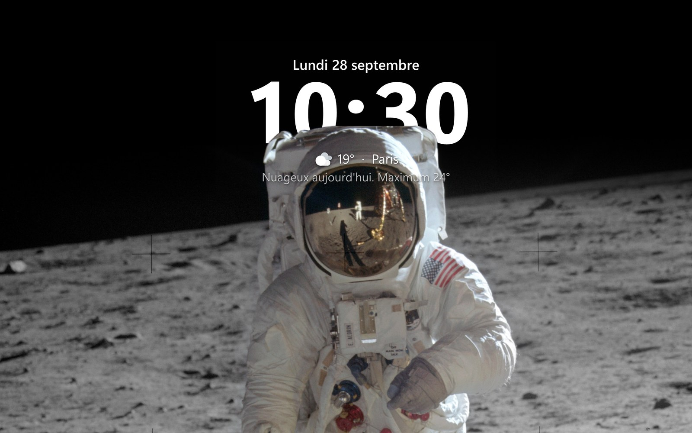
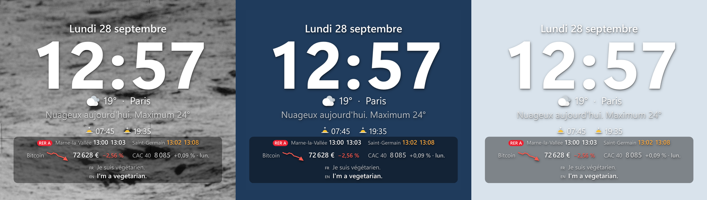
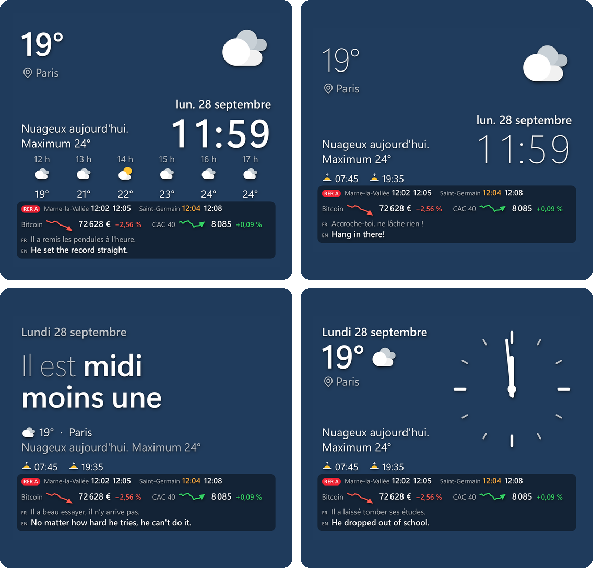
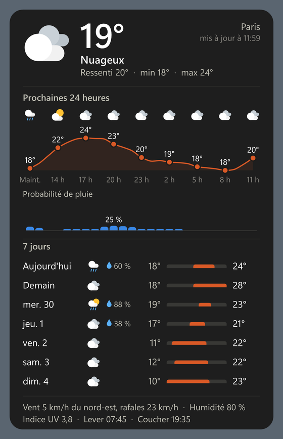
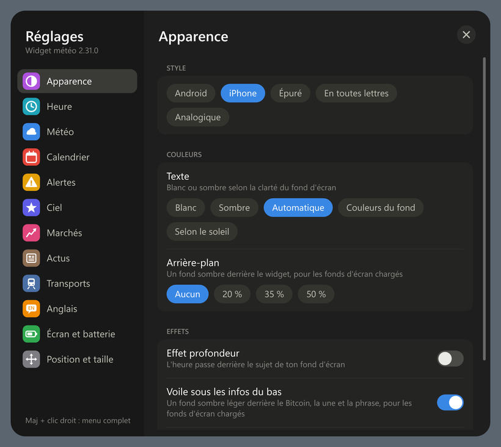
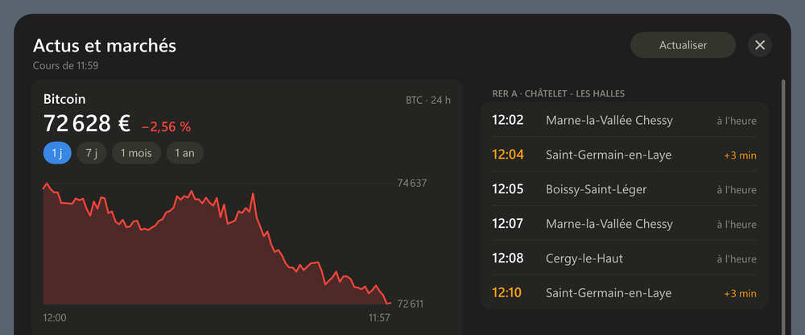

# Widget météo pour Windows


Une horloge et la météo posées sur ton bureau Windows, façon Android ou iPhone :
l'heure en grand, le temps qu'il fait, la pluie qui arrive, tes prochains trains,
le Bitcoin, les titres du jour et même une phrase d'anglais à apprendre. Le tout
en un seul script AutoHotkey, gratuit, sans compte et sans publicité : tes
réglages et tes données restent sur ton PC.



*L'effet profondeur, comme sur l'iPhone : l'heure passe derrière le sujet de ton fond
d'écran, détouré automatiquement sur ton PC. (Photo : Buzz Aldrin sur la Lune, Apollo 11,
NASA, domaine public.)*



*Le même widget sur trois fonds d'écran : ses couleurs s'adaptent toutes seules.*

## Ce qu'il sait faire

**L'heure et la météo**
- 5 styles : Android, iPhone, Épuré, En toutes lettres (« Il est midi moins une ») et Analogique.
- Prévisions détaillées d'un clic : les 24 prochaines heures, la probabilité de pluie, les 7 jours.
- « Pluie dans 20 min, jusqu'à 15 h 30 » : une pastille seulement quand une averse arrive dans l'heure.
- Vigilance Météo-France, qualité de l'air, pollens, sable du Sahara, UV fort, Seine haute,
  normales de saison et records, une deuxième ville (sa météo et son heure).

**Un bureau vivant**
- Texte blanc ou sombre selon la clarté du fond d'écran, ou à ses couleurs.
- Effet profondeur : l'heure passe derrière le sujet de ta photo (option, avec Python).
- Ambiances nuit, pluie, neige (option, avec Python) ; mode nuit, protection des écrans OLED,
  mode sobre sur batterie.

**Le calendrier**
- Numéro de semaine, jours fériés, vacances scolaires (zones A, B, C), comptes à rebours.
- « Mes jours » : ton planning de travail, de repos et de congés, cycles compris (2-2-3…).
- Anniversaires avec l'âge, et une pluie de confettis le jour J.
- Lever et coucher du soleil et de la lune, durée du jour, saisons, passages de l'ISS,
  planètes visibles, étoiles filantes.

**Actus et marchés**
- Le Bitcoin sur le widget : une mini-courbe et une flèche, verte quand il monte, rouge quand il baisse.
- Un indice boursier (CAC 40, S&P 500…) et un tableau de bord : cryptos, indices,
  actions du CAC 40 et taux, avec des alertes quand ça bouge fort.
- Les titres de franceinfo et du Monde ; un clic sur un titre ouvre l'article en grand
  (texte complet pour franceinfo).

**Les transports en Île-de-France**
- Les prochains départs de ta gare ou de ton arrêt (RER, Transilien, métro, tram, bus),
  dans les deux sens, avec les retards, les suppressions et les perturbations.

**Apprendre l'anglais**
- Une phrase en français et sa traduction toutes les 5 minutes (470 intégrées, plus
  celles de Tatoeba) ; un clic sur la phrase : la suivante.



| Prévisions détaillées | Réglages |
|---|---|
|  |  |



## Installation

1. Installe [AutoHotkey v2](https://www.autohotkey.com/) (64 bits).
2. Télécharge ce dépôt (bouton **Code ▸ Download ZIP**, puis décompresse-le où tu veux)
   ou clone-le :
   ```bash
   git clone https://github.com/mesix971/widget-meteo.git
   ```
3. Double-clique sur `widget-meteo.ahk`. Le widget apparaît en haut à droite de l'écran ;
   un **clic droit** dessus ouvre le menu, puis **Réglages**.
4. Pour le lancer avec Windows : `Win + R`, tape `shell:startup`, et places-y un
   raccourci vers `widget-meteo.ahk`.

Testé sous Windows 11. La météo marche partout (position par le service de
localisation de Windows, sinon par l'adresse IP) ; les vacances scolaires, la
vigilance, la qualité de l'air et les transports sont ceux de la France.

### Options

- **Effet profondeur et ambiances** : Python 3.11, puis
  ```bash
  py -3.11 -m pip install -r requirements.txt
  ```
  Le modèle de détourage (BiRefNet, 224 Mo) se télécharge depuis **Réglages ▸ Apparence**.
- **Transports en Île-de-France** : crée un jeton gratuit sur
  [prim.iledefrance-mobilites.fr](https://prim.iledefrance-mobilites.fr) (un compte, puis
  *Mes jetons d'authentification ▸ API ▸ Générer mon jeton*), colle-le dans
  **Réglages ▸ Transports ▸ Jeton**, puis choisis ta gare ou ton arrêt par son nom.
  Le widget reste sous le quota gratuit (1 000 requêtes par jour).

## Au quotidien

| Geste | Effet |
|---|---|
| Clic sur l'illustration ou la température | Prévisions détaillées |
| Clic sur le Bitcoin, l'indice ou les départs | Tableau de bord « Actus et marchés » |
| Clic sur un titre | L'article en grand (◀ ▶ pour les autres, Échap pour fermer) |
| Clic sur la phrase d'anglais | La phrase suivante |
| Glisser le widget | Le déplacer (les bords le redimensionnent, sauf s'il est verrouillé) |
| Clic droit | Petit menu : prévisions, Mes jours, Réglages, actualiser, quitter |
| Maj + clic droit | Le menu complet |

## Tes données restent chez toi

Tout est rangé dans `%LOCALAPPDATA%\WidgetMeteo\` : réglages (`reglages.ini`), planning
(`jours.txt`), anniversaires, jeton Île-de-France Mobilités (`cle-idfm.txt`), dernières
données reçues et journaux. Rien de tout ça n'est envoyé nulle part : le widget ne fait
que lire des services publics gratuits, en leur donnant le strict nécessaire (ta
position approximative pour la météo, ta gare pour les départs).

## Sources de données

Toutes gratuites ; aucune clé sauf le jeton gratuit des transports franciliens.

| Données | Source |
|---|---|
| Météo, prévisions, qualité de l'air, normales et records (ERA5), géocodage | [Open-Meteo](https://open-meteo.com/) (CC BY 4.0) |
| Nom de la ville | [BigDataCloud](https://www.bigdatacloud.com/), [Nominatim](https://nominatim.openstreetmap.org/) (© les contributeurs d'OpenStreetMap) |
| Position de secours | [ipwho.is](https://ipwho.is/) |
| Vigilance | [MeteoAlarm](https://meteoalarm.org/) (Météo-France) |
| Épisodes de pollution, pollens | [Airparif](https://www.airparif.fr/), [Atmo France](https://www.atmo-france.org/) |
| Niveau de la Seine | [Hub'Eau](https://hubeau.eaufrance.fr/) |
| Vacances scolaires, communes | [data.education.gouv.fr](https://data.education.gouv.fr/), [geo.api.gouv.fr](https://geo.api.gouv.fr/) |
| Passages de l'ISS | [CelesTrak](https://celestrak.org/) |
| Cryptos | [CoinGecko](https://www.coingecko.com/) |
| Bourses | Yahoo Finance (API non officielle) |
| Taux européens | [Banque centrale européenne](https://data.ecb.europa.eu/) |
| Titres | Flux RSS du Monde, de franceinfo et de France 24 |
| Phrases d'anglais | [Tatoeba](https://tatoeba.org/) (CC BY 2.0 FR) |
| Transports | [Île-de-France Mobilités](https://prim.iledefrance-mobilites.fr/) (open data et API PRIM) |
| Détourage (option) | [BiRefNet](https://github.com/ZhengPeng7/BiRefNet), modèle distribué par [rembg](https://github.com/danielgatis/rembg) |

## Sous le capot

| Fichier | Rôle |
|---|---|
| `widget-meteo.ahk` | Le widget : dessin (GDI+), fenêtres, zones cliquables, réglages. |
| `widget-meteo-*.ahk` | Ses modules : prévisions, styles, heure, calendrier, infos, Mes jours, lumière, anniversaires, air, climat, ciel, lune, marchés, fiche d'actualité, transports, anglais, écran, Réglages. |
| `widget-meteo-veille.ahk` | Veille (option) : relance le widget s'il a disparu, sauf si tu l'as quitté toi-même. À lancer toutes les 5 minutes avec le Planificateur de tâches. |
| `widget-meteo-donnees.ps1` | Collecte météo, position, calendrier, vigilance, air, climat, ISS. |
| `widget-meteo-marches.ps1` | Collecte des marchés, des titres, des phrases Tatoeba et des départs ; recherche d'arrêts. |
| `widget-meteo-fond.py` | Analyse du fond d'écran et ambiances (option). |
| `widget-meteo-anglais.txt` | Les 470 phrases intégrées. |
| `CHANGELOG-widget-meteo.md` | L'historique des versions. |

Chaque module a ses auto-tests. Ils écrivent dans le dossier de données : lance-les
avec un dossier de test, jamais sur le tien. En PowerShell :

```powershell
$env:LOCALAPPDATA = "$env:TEMP\widget-test"
& "C:\Program Files\AutoHotkey\v2\AutoHotkey64.exe" widget-meteo.ahk /testreglages "$env:TEMP\resultat.txt"
```

(aussi `/testmarches`, `/testrer`, `/testpluie`, `/testjours`, `/testfiche`… ; le résultat
est écrit dans le fichier donné).

## In English

A clock and weather widget for the Windows desktop, Android/iPhone style, written in
AutoHotkey v2: five styles, detailed forecasts, rain-in-the-next-hour alerts, a work
and holiday planner, Bitcoin and stock market tracking with a dashboard, French news
headlines, Paris-area public transport departures, and a French → English phrase every
five minutes. Free, no account, no API key; everything stays on your PC. The interface
is in French. Install [AutoHotkey v2](https://www.autohotkey.com/), download this
repository and double-click `widget-meteo.ahk`.

## Licence

[MIT](LICENSE) : tu peux l'utiliser, le modifier et le partager librement.
